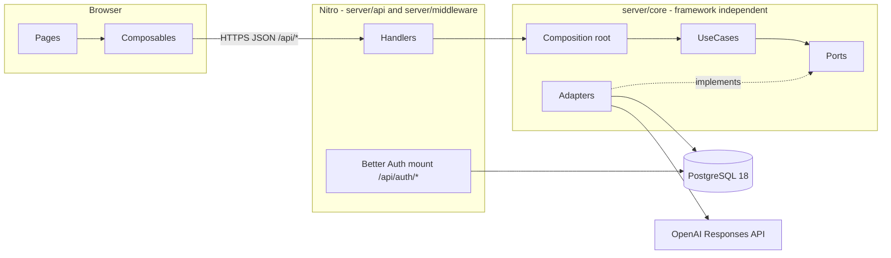
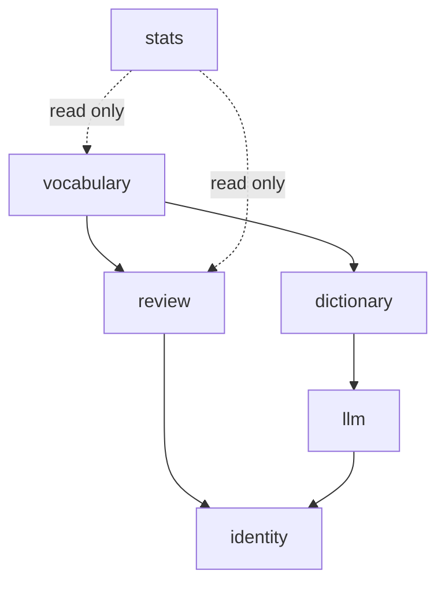
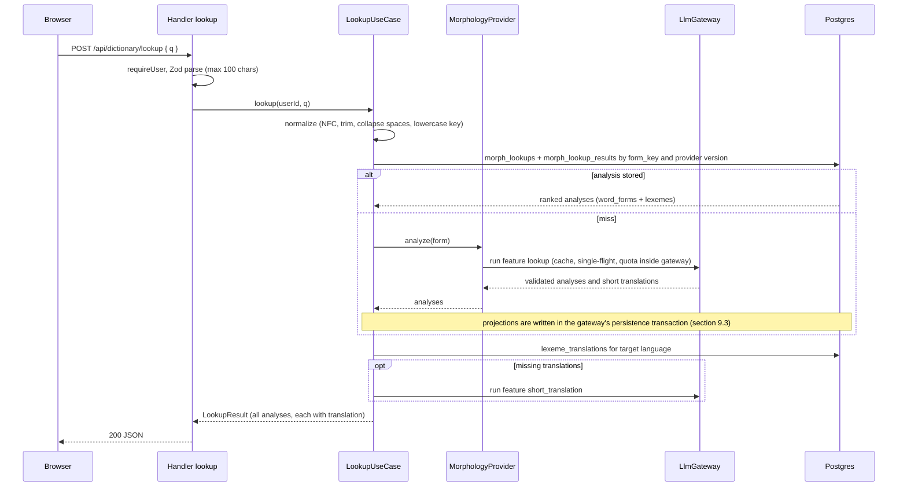
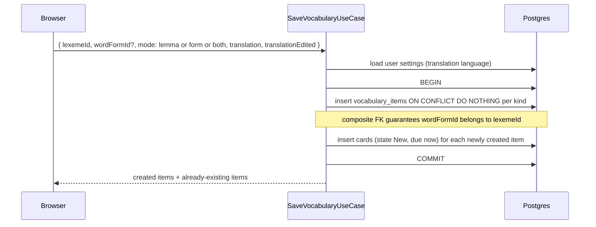

# Architecture: Polish Learning App

Status: Approved; implementation in progress (revision 3)
Last updated: 2026-11-10

Related documents: [PRD.md](PRD.md), [DECISIONS.md](DECISIONS.md), [../AGENTS.md](../AGENTS.md), [../README.md](../README.md)

This document describes the target architecture for the MVP. **Implemented so far:** Phase 1 (2026-11-09): project skeleton, Docker Compose PostgreSQL, Drizzle client and migration tooling, config parsing, composition root, `GET /api/health`, lint boundary rules, and test infrastructure. Phase 2 (2026-11-10): Better Auth with Google and the allowlist (section 8), the identity module (settings, allowlist), `GET /api/me`, `PATCH /api/settings`, the CSRF middleware, test-only session seeding, and the login, dashboard (placeholder), and settings screens. Phase 3 steps 3.0–3.1 (2026-11-14): the LLM evaluation kit, which includes draft prompts, accounting functions, the `LlmProvider` port with its OpenAI adapter, the model price table, and an offline-tested evaluation harness (`tests/eval/`). The gateway, dictionary module, and database tables are not built yet. Everything else is still the plan. Where a choice involves a real tradeoff, the alternatives are described so the decision can be revisited.

---

## 1. Overview

The app is a **modular monolith**: one Nuxt 4 application that serves the Vue frontend and the API (through Nitro), backed by one PostgreSQL database. Business logic lives in a framework-independent core under `server/core/`. Nitro route handlers are thin adapters around it.



### 1.1 Technology baseline

Versions checked against official sources on 2026-11-08. Exact versions are pinned in `package.json` and `pnpm-lock.yaml`. Installed in Phase 1 (2026-11-09): nuxt 4.6.4, @nuxt/ui 4.12.0, tailwindcss 4.3.5, zod 4.6.7, drizzle-orm 0.45.4, drizzle-kit 0.31.11, pg 8.23.1, typescript 6.0.3, vue-tsc 3.3.14, vitest 5.1.0, @playwright/test 1.65.0, eslint 10.14.0, @nuxt/eslint 1.17.0, pnpm 12.18.0. Installed in Phase 3 (2026-11-14): openai 7.56.0 (D-37).

| Concern | Choice | Version line | Notes |
| --- | --- | --- | --- |
| Runtime | Node.js | 26.x LTS ("Lithium") | Active LTS since 2026-10-28 ([Node release schedule](https://github.com/nodejs/Release)). ts-fsrs v6 requires Node ≥ 24. |
| Package manager | pnpm | 12.x, pinned via `packageManager` | Node 26 no longer bundles Corepack; see README for installation (D-23). |
| Framework | Nuxt | 4.6.x (4.6.4 at time of writing) | 4.6.4 is a security release and bundles nitropack 2.13.6 ([releases](https://github.com/nuxt/nuxt/releases)). Nitro v2 / h3 v1 is the default server runtime. |
| UI | Nuxt UI | 4.x | Requires Nuxt ≥ 4.1; installed together with `tailwindcss` ([install guide](https://ui.nuxt.com/docs/getting-started/installation/nuxt)). |
| Styling | Tailwind CSS | 4.x | CSS-first config: `@import "tailwindcss"; @import "@nuxt/ui";` |
| Validation | Zod | 4.x (4.6.x) | Shared between client, server, and LLM structured outputs. |
| Database | PostgreSQL | 18.x (18.6) | Docker image `postgres:18.6`. Built-in `uuidv7()`. Volume path changed to `/var/lib/postgresql` in 18 ([image docs](https://hub.docker.com/_/postgres/)). |
| ORM | Drizzle ORM + drizzle-kit | 0.45.x stable (1.0 is at rc.5) | Driver: `node-postgres` (`pg`). See [DECISIONS.md](DECISIONS.md) OD-01. |
| Auth | Better Auth | 1.7.x | Core library mounted directly, Drizzle adapter, Google provider ([Nuxt integration](https://better-auth.com/docs/integrations/nuxt), [Google](https://better-auth.com/docs/authentication/google), [security](https://better-auth.com/docs/reference/security)). |
| Spaced repetition | ts-fsrs | 6.x | v6 supports FSRS-3 … FSRS-7; `DefaultScheduler` defaults to FSRS-7 ([updates](https://open-spaced-repetition.github.io/ts-fsrs/updates/)). See OD-02. |
| LLM | OpenAI (`openai` SDK) | current | Responses API, `responses.parse()` + `zodTextFormat()` ([structured outputs](https://github.com/openai/openai-node/blob/main/docs/structured-outputs.md)). |
| Type checking | TypeScript + vue-tsc | TS 6.0.x, vue-tsc 3.x | Not TS 7: the native compiler is not supported by `vue-tsc` / `nuxt typecheck` (D-23). |
| Unit/integration tests | Vitest | current | |
| E2E tests | Playwright | current | |

### 1.2 Approved dependencies

This list is the **single source of truth** for what may be installed during initial scaffolding without asking again (see [AGENTS.md](../AGENTS.md) section 6). Versions must stay within the major line in section 1.1, and the latest patch should be used.

| Kind | Packages | Purpose |
| --- | --- | --- |
| Runtime | `nuxt` | Framework (brings Vue, Nitro, h3, Vite) |
| Runtime | `@nuxt/ui`, `tailwindcss` | UI components and styling |
| Runtime | `@iconify-json/lucide` | Local icon set used by Nuxt UI (avoids runtime icon API calls) |
| Runtime | `zod` | Validation |
| Runtime | `drizzle-orm`, `pg` | Database access |
| Runtime | `better-auth` | Authentication |
| Runtime | `ts-fsrs` | Scheduling |
| Runtime | `openai` | LLM provider SDK |
| Dev | `typescript`, `vue-tsc`, `@types/node`, `@types/pg` | Type checking |
| Dev | `drizzle-kit` | Migrations |
| Dev | `vitest` | Unit and integration tests |
| Dev | `@playwright/test` | E2E tests (plus its browser download) |
| Dev | `eslint`, `@nuxt/eslint` | Linting, including boundary rules |

Also covered:

- Transitive dependencies of the packages above.
- Nuxt modules that `@nuxt/ui` registers itself (`@nuxt/icon`, `@nuxt/fonts`, `@nuxtjs/color-mode`).
- The Better Auth CLI, run on demand with `pnpm dlx auth@<same version as better-auth>`. It is not added as a dependency.

Anything else needs approval: for example `@nuxt/test-utils`, `@vue/test-utils`, `happy-dom`, `@nuxtjs/i18n`, Pinia, date libraries, or any infrastructure client.

Deliberately **not** used: Redis, message queues, a separate API server (Fastify/Express), microservices, a client-side state library beyond Vue/Nuxt built-ins. Section 12 explains why.

---

## 2. Architectural principles

1. **Core is framework-independent.** `server/core/**` must not import `h3`, `nitropack`, `nuxt`, `#imports`, `#shared`, or Vue. It depends only on TypeScript, Zod, Drizzle, ts-fsrs, `openai`, and `better-auth` (the core library, which is itself framework-agnostic).
2. **Handlers are thin.** A Nitro handler only (a) authenticates, (b) parses and validates input with a shared Zod schema, (c) calls one use case, and (d) maps the result or domain error to HTTP.
3. **Ports at the edges of the core.** Use cases depend on interfaces (`VocabularyRepository`, `LlmGateway`, `MorphologyProvider`, `Scheduler`, `Clock`). Adapters implement them. This is what makes testing without a database or OpenAI possible, and what makes the morphology provider swappable.
4. **One composition root.** `server/core/container.ts` wires adapters to use cases from a plain config object. Nitro builds the container once per process. A future Fastify server would build the same container.
5. **Database is the only shared state, and it enforces integrity.** Uniqueness, ownership, and lexeme/form consistency are guaranteed by constraints, not only by application checks. The only in-memory state is the LLM single-flight map, which is an optimization and never needed for correctness.
6. **Authorization by construction.** Every use case that touches user data takes `userId` as an explicit argument, and every repository method filters by it.
7. **User data is never changed silently.** Saved translations, card content, and review history change only through an explicit user action.

### Tradeoff: single package vs pnpm workspace

| Option | Pros | Cons |
| --- | --- | --- |
| **Single Nuxt package with `server/core/` (chosen)** | One `package.json`, one tsconfig tree, no build orchestration, fastest to start. | Boundaries are enforced by lint rules, not by the package system. |
| pnpm workspace (`apps/web`, `packages/core`) | Hard boundaries; core can be published or reused by a Fastify app without moving files. | Extra tooling (TS project references, build or transpile of `packages/core`, Nuxt transpile config) for a project with a few users. |

The single package is enough while there is one deployable. When the backend is extracted (section 11), `server/core/` moves into `packages/core` mostly as-is, because it has no Nuxt imports.

---

## 3. Repository layout

Paths marked `(P1)` exist since Phase 1; the rest are planned.

```text
.
├─ app/                         # Nuxt 4 app directory (client + SSR) (P1)
│  ├─ pages/                    # index = dashboard, the default landing page (P1, D-18); review, search, vocabulary, settings, login
│  ├─ components/
│  ├─ composables/              # useUiStrings (P1); useApi, useAuth, useReviewSession, ...
│  ├─ locales/en.ts             # all UI strings (prepares later i18n) (P1)
│  ├─ layouts/                  # default.vue (P1)
│  ├─ middleware/auth.global.ts # redirects signed-out users to /login, signed-in users away from it (P2)
│  └─ assets/css/main.css       # @import "tailwindcss"; @import "@nuxt/ui"; (P1)
├─ shared/
│  └─ contracts/                # Zod request/response schemas used by client and server (P1: health.ts)
├─ server/
│  ├─ api/                      # thin Nitro handlers (see section 5) (P1: health.get.ts)
│  │  └─ auth/[...all].ts       # Better Auth mount
│  ├─ middleware/               # origin check for mutating /api requests (never reads the body)
│  ├─ plugins/container.ts      # builds the container at startup, disposes it on close (P1)
│  ├─ utils/                    # useContainer() (P1); requireUser(event), toHttpError()
│  └─ core/                     # framework-independent code (no Nuxt/h3 imports)
│     ├─ container.ts           # composition root (P1)
│     ├─ config.ts              # typed config parsed from process.env with Zod (P1, D-24)
│     ├─ auth/                  # betterAuth() instance factory, allowlist hooks
│     ├─ db/
│     │  ├─ client.ts           # pg Pool + drizzle() (P1)
│     │  ├─ health.ts           # database health check (P1)
│     │  └─ schema/index.ts     # schema entry; one file per module + auth-schema.ts (P1: empty)
│     ├─ shared/                # errors, Result, Clock, ids, text normalization
│     └─ modules/
│        ├─ identity/           # settings, allowlist (P2)
│        ├─ dictionary/         # lookup, details, morphology port, lexeme identity, reports
│        ├─ vocabulary/
│        ├─ review/             # cards, FSRS scheduling, review queue
│        ├─ stats/
│        └─ llm/                # gateway, OpenAI adapter, cache, usage, quotas, prompts
├─ drizzle/                     # generated SQL migrations (committed) (P1: empty journal)
├─ docs/operations.sql          # operator queries and procedures (section 16), added with implementation
├─ docker/postgres/initdb/      # first-start init scripts, creates <db>_test (P1)
├─ tests/
│  ├─ support/                  # test DB URL guard, migration helper (P1)
│  ├─ integration/              # Vitest against Docker Postgres (P1)
│  └─ e2e/                      # Playwright, desktop + mobile projects (P1)
├─ docker-compose.yml           # (P1)
├─ drizzle.config.ts            # (P1)
├─ eslint.config.mjs            # includes the boundary rules of AGENTS.md section 3 (P1)
├─ nuxt.config.ts               # (P1)
├─ vitest.config.ts             # projects: unit, integration (P1)
├─ playwright.config.ts         # (P1)
└─ .env.example                 # (P1)
```

Unit tests are colocated with the code they test (`*.test.ts` under `server/core/` and `shared/`).

Each module under `server/core/modules/<name>/` has the same internal shape:

```text
<module>/
├─ domain/          # entities, value objects, pure functions, domain errors
├─ application/     # use cases + port interfaces (e.g. VocabularyRepository)
├─ infrastructure/  # Drizzle repositories, external adapters
└─ index.ts         # public API of the module (use case factories, types)
```

Why `server/core/` is inside `server/`: Nitro only auto-scans `server/api`, `server/routes`, `server/middleware`, `server/plugins`, and auto-imports `server/utils`. `server/core` is neither scanned nor auto-imported, so all imports there are explicit, which is what makes it portable.

Contracts in `shared/contracts/` are plain Zod and TypeScript. The client imports them through Nuxt's `#shared` alias. `server/core` imports them with relative paths so it doesn't depend on a Nuxt alias.

---

## 4. Module boundaries

| Module | Responsibility | Owns tables | Depends on |
| --- | --- | --- | --- |
| `identity` | User settings, allowlist, "who am I" | `user_settings`, `allowed_emails` (plus Better Auth tables, owned by `auth`) | shared |
| `dictionary` | Lookup (normalize, analyze, translate), details, lexeme identity, problem reports, `MorphologyProvider` port | `lexemes`, `word_forms`, `morph_lookups`, `morph_lookup_results`, `lexeme_translations`, `content_reports` | llm, shared |
| `vocabulary` | Saving lemma/form/both, translation snapshots, listing, editing, re-translation, archiving, deleting | `vocabulary_items` | dictionary (read lexeme/form/translation by id), review (create/suspend cards), shared |
| `review` | Cards, FSRS scheduling, review queue, answers | `cards`, `review_logs` | identity (settings), shared |
| `stats` | Read-only aggregates over review data | none (reads `cards`, `review_logs`, `vocabulary_items`) | shared |
| `llm` | `LlmGateway`, OpenAI adapter, prompt registry, cache, single-flight, usage tracking, quotas | `llm_cache`, `llm_usage` | identity (per-user limit overrides), shared |

FSRS-scheduled review is the **only** study mode in the MVP (D-19). There is no separate practice model. `cards` and `review_logs` are the whole learning data model.

Rules:

- A module calls another module only through that module's `index.ts` exports, never by reaching into its `domain/` or `infrastructure/`.
- Modules do not query other modules' tables directly. The one exception is `stats`, which is an explicitly read-only reporting module and may read `review` and `vocabulary` tables.
- Cross-module writes that must be atomic (for example "save vocabulary item + create card", or "LLM cache insert + dictionary projections") go through a `UnitOfWork` port that passes one Drizzle transaction to the repositories involved.
- These rules are enforced with ESLint `no-restricted-imports` patterns (no extra dependency) and checked in code review.



---

## 5. HTTP API surface (MVP)

All endpoints are JSON, under `/api`, and require an authenticated session except `/api/auth/*` and `/api/health`. Request and response bodies are defined in `shared/contracts/`.

| Method | Path | Use case | LLM? |
| --- | --- | --- | --- |
| GET | `/api/health` | Readiness: `{ status, database }`, 503 when the database is down; no error details (D-26). **Implemented** | no |
| `*` | `/api/auth/*` | Better Auth (sign-in, callback, session, sign-out). **Implemented** | no |
| GET | `/api/me` | Current user and settings. **Implemented**; today's LLM usage and limits are added with the LLM phase | no |
| PATCH | `/api/settings` | Update settings (partial, `.strict()`). **Implemented** | no |
| POST | `/api/dictionary/lookup` | Search: analyses + short translations | maybe (cache miss) |
| POST | `/api/dictionary/details` | Meanings, examples, forms for a lexeme in the current language | maybe (cache miss) |
| POST | `/api/dictionary/reports` | Report a wrong AI result | no |
| GET | `/api/vocabulary` | List with filter/sort/pagination | no |
| POST | `/api/vocabulary` | Save lemma / form / both (idempotent per natural key) | no |
| GET | `/api/vocabulary/:id` | Item detail, card state, review history | no |
| PATCH | `/api/vocabulary/:id` | Edit translation/note, archive/unarchive | no |
| POST | `/api/vocabulary/:id/translation-preview` | Proposed translation in the current language | maybe (cache miss) |
| PUT | `/api/vocabulary/:id/translation` | Apply a confirmed re-translation | no |
| DELETE | `/api/vocabulary/:id` | Delete item, card, logs | no |
| GET | `/api/review/queue` | Today's counts + next cards with interval previews | no |
| POST | `/api/review/answers` | Record rating (idempotent by `clientReviewId`); returns updated card and next queue head | no |
| GET | `/api/stats/overview` | Dashboard aggregates | no |

Lookup, details, and translation preview use `POST` even though they read, because a cache miss consumes quota and calls a paid API. Not exposing them as `GET` keeps them out of prefetching, link previews, and CSRF-by-image.

---

## 6. Request flows

### 6.1 Sign-in (Google OAuth through Better Auth)

```mermaid
sequenceDiagram
  participant B as Browser
  participant N as Nitro auth mount
  participant BA as Better Auth core
  participant G as Google
  participant DB as Postgres
  B->>N: POST /api/auth/sign-in/social provider=google
  N->>BA: auth.handler(toWebRequest(event))
  BA-->>B: redirect URL to Google (state + PKCE)
  B->>G: consent
  G-->>B: redirect /api/auth/callback/google?code=...&state=...
  B->>N: GET callback
  N->>BA: auth.handler(toWebRequest(event))
  BA->>G: exchange code, read profile (sub, email, email_verified)
  BA->>DB: find account by provider + Google sub
  alt new user
    BA->>DB: user.create.before hook - allowlisted and verified?
    BA->>DB: insert user, account; user.create.after creates user_settings
  else returning user
    BA->>DB: reuse user and account
  end
  BA->>DB: session.create.before hook - stored email still allowlisted?
  alt rejected by either hook
    BA-->>B: redirect /login?error=not_invited
  else allowed
    BA->>DB: insert session
    BA-->>B: Set-Cookie session token, redirect /
  end
```

### 6.2 Lookup (search)



In the MVP the LLM morphology provider asks for analyses **and** short translations in the same structured call (one round trip, lower latency). The result is split before storage: analyses go into language-independent tables (`lexemes`, `word_forms`, `morph_lookups`, `morph_lookup_results`), and translations go into `lexeme_translations` per language. That way a future dictionary-based provider can replace only the analysis half, and a user switching translation language only triggers the cheaper translation-only call.

### 6.3 Details

1. Handler validates `{ lexemeId }` and calls `GetDetailsUseCase(userId, lexemeId)`.
2. The use case loads the lexeme and the user's **current** translation language.
3. The `LlmGateway` runs feature `details`, keyed by `(lexemeId, targetLanguage, promptVersion, model)`. It returns a cached result or performs a quota-checked call.
4. The validated JSON (meanings, examples, forms table) is returned. Forms returned in details are upserted into `word_forms` (same natural-key rules as lookup), so they can be saved later.

Details never modify saved vocabulary items.

### 6.4 Save to vocabulary



- The translation snapshot is whatever the user confirmed in the save dialog: the cached short translation (`translation_source = 'generated'`) or their edited text (`'edited'`).
- For "both", the lemma item and the form item each get their own snapshot and card.
- `ON CONFLICT DO NOTHING` on the partial unique indexes makes double clicks and parallel tabs safe. Existing items are returned unchanged. Their translation is **not** overwritten by a repeated save.

### 6.5 Review answer

```mermaid
sequenceDiagram
  participant B as Browser
  participant UC as AnswerReviewUseCase
  participant S as Scheduler port (ts-fsrs)
  participant DB as Postgres
  B->>UC: { cardId, rating, clientReviewId, durationMs }
  UC->>DB: BEGIN; SELECT review_logs by (user_id, client_review_id)
  alt already recorded
    UC-->>B: previous result (idempotent)
  else new
    UC->>DB: SELECT card WHERE id AND user_id AND suspended_at IS NULL FOR UPDATE
    UC->>S: next(cardState, now, rating, desiredRetention)
    S-->>UC: new card state + log entry
    UC->>DB: UPDATE cards; INSERT review_logs
    UC->>DB: COMMIT
    UC-->>B: updated card summary + next queue head
  end
```

- `now` comes from the `Clock` port, so scheduling is deterministic in tests.
- The unique index on `review_logs (user_id, client_review_id)` is the final guard against double submits. If two identical requests race past the first `SELECT`, the second insert fails on the unique index, the transaction rolls back, and the use case returns the stored result.
- **Queue composition** (`GET /api/review/queue` and the "next" part of the answer response), in order:
  1. learning/relearning cards with `due <= now`
  2. review cards with `due <= now`, oldest due first
  3. new cards, oldest `created_at` first, up to `daily_new_limit` minus the new cards already introduced today (counted from `review_logs` with `state_before = New` since the start of the user's local day)
  Cards in a learning step that are not yet due are reported as "coming back in N minutes", so the client can poll when the next one becomes due.

### 6.6 Re-translate a saved item into the current language

1. `POST /api/vocabulary/:id/translation-preview`: loads the item (scoped by user), takes the user's current language, and reads `lexeme_translations` or runs the `short_translation` feature through the gateway (counts toward the lookup limit on a cache miss). It returns `{ proposedTranslation, language, currentTranslation, currentSource, requiresOverwriteConfirmation, itemVersion }`. Nothing is written to the item.
2. `PUT /api/vocabulary/:id/translation` with `{ translation, language, confirmOverwriteEdited, expectedVersion }`:
   - `409` if `expectedVersion` doesn't match `translation_updated_at` (the item changed meanwhile)
   - `409` if the current source is `edited` and `confirmOverwriteEdited` is not `true`
   - otherwise updates `translation`, `translation_language`, `translation_source = 'generated'`, `translation_updated_at`
   - The card's FSRS state is not touched.

---

## 7. Database design (initial)

Conventions:

- Table and column names are `snake_case`. Drizzle schema property names are `camelCase`.
- **IDs (D-28):** entity primary keys are `uuid DEFAULT uuidv7()`, generated by PostgreSQL 18 (time-ordered, index-friendly). This includes the Better Auth tables: Better Auth runs with `advanced.database.generateId: false`, so it inserts without an ID and reads back the database-generated one. All FKs to `"user".id` are `uuid`. Application code never generates entity IDs. Exceptions: tables with natural or composite keys (`allowed_emails`, `user_settings`, `lexeme_translations`, `morph_lookup_results`) and `review_logs.client_review_id`, which is an idempotency key generated by the client.
- All timestamps are `timestamptz` and stored in UTC. Local-day logic for reviews and stats uses the user's IANA `timezone`. LLM quotas use the UTC day (section 9.2).
- Enumerations are `text` columns with `CHECK` constraints rather than PostgreSQL enums, because adding values to a PostgreSQL enum in migrations is awkward and adding to a `CHECK` is not.
- Every user-owned table has `user_id` with `ON DELETE CASCADE` from `"user"`.
- Shared dictionary rows are never deleted through user actions. References from user data to dictionary rows use `ON DELETE RESTRICT`.
- Concurrent creation always uses `INSERT ... ON CONFLICT DO NOTHING` followed by a `SELECT` on the natural key. No select-then-insert.
- Migrations are generated by drizzle-kit into `drizzle/`, reviewed, and committed. Applied migrations are never edited. Constraints that Drizzle can't express (partial unique indexes, `IS NFC NORMALIZED` checks, composite FKs if unsupported) go into hand-written SQL migrations.

### 7.1 Authentication (generated by Better Auth CLI, owned by `auth`)

All four tables use `id uuid DEFAULT uuidv7()` and `timestamptz` columns. The CLI output is adjusted to these conventions before the first migration, and an integration test checks that Better Auth stores and reads back database-generated UUIDv7 IDs.

- `user` (id, name, email, email_verified, image, created_at, updated_at)
- `session` (id, user_id, token, expires_at, ip_address, user_agent, ...)
- `account` (id, user_id, provider_id, account_id = Google `sub`, tokens (encrypted), ...), plus `UNIQUE (provider_id, account_id)` (not in Better Auth's default schema)
- `verification` (OAuth state and similar short-lived records)

The schema is generated once with the Better Auth CLI into `server/core/db/schema/auth-schema.ts` and then owned by our migrations. It is regenerated only when Better Auth config or plugins change.

### 7.2 Identity

```text
allowed_emails
  email            text PK        -- stored lowercased, CHECK (email = lower(email))
  note             text null
  created_at       timestamptz

user_settings
  user_id              uuid PK FK -> user.id
  ui_locale            text  default 'en'   CHECK in ('en')         -- widened when UI locales ship
  translation_language text  default 'ru'   CHECK in ('ru','en','uk')
  timezone             text  null           -- IANA name; null until the client reports the browser zone;
                                            -- treated as 'Europe/Warsaw' while null
  daily_new_limit      int   default 20     CHECK 0..200
  desired_retention    numeric(3,2) default 0.90 CHECK 0.70..0.97
  llm_daily_lookup_limit  int null          -- per-user overrides of global defaults (added with the LLM phase)
  llm_daily_details_limit int null
  created_at, updated_at
```

`user_settings` is created in Better Auth's `user.create.after` hook. Because that hook runs after the user insert, the settings repository also does a get-or-create on read, so a failed hook can't leave a user without settings.

### 7.3 Dictionary (shared across users, no `user_id`)

Dictionary knowledge is not personal, so it is stored once and reused by everyone. This is the main reason caching pays off with few users.

#### Lexeme identity rules

A lexeme is identified by **`(lemma_key, pos, discriminator)`**:

- `lemma_key`: the lemma normalized by the single `normalize()` function (Unicode NFC, trimmed, single spaces, lowercase).
- `pos`: a fixed set: `noun, verb, adj, adv, pron, num, prep, conj, part, interj, phrase`.
- `discriminator`: derived **by code** from lexeme-level grammar, never written freely by the LLM:
  - nouns: grammatical gender (`m1`, `m2`, `m3`, `f`, `n`) or `pt` for plural-only nouns
  - verbs: aspect (`impf`, `pf`, `biasp`)
  - all other parts of speech: `''`

Consequences:

- Homonyms with the same lemma, part of speech, and paradigm (`zamek`: castle/lock/zipper) are **one lexeme with several meanings**. Meanings live in details and in the user's translation snapshot, not in lexeme identity. This avoids the unreliable task of having an LLM split senses consistently.
- Aspect partners (`robić`/`zrobić`) are separate lexemes, because their lemmas differ.
- Words that genuinely differ in grammar (different gender or aspect) get separate lexemes automatically.
- Known accepted limitations: case-only differences collapse (`Polak` "Pole" vs `polak` colloquial "Polish teacher"). The displayed `lemma` keeps the first-seen casing. If the LLM reports a different gender for the same noun on another call, a second lexeme can appear. Both cases are handled by the operator merge procedure (section 16), not by extra schema.

```text
lexemes
  id             uuid PK
  lemma          text            -- as displayed, e.g. 'pies', 'Kraków'
  lemma_key      text            -- CHECK (lemma_key <> '' AND lemma_key IS NFC NORMALIZED AND lemma_key = lower(lemma_key))
  pos            text            -- CHECK in (...)
  discriminator  text NOT NULL DEFAULT ''   -- CHECK in ('', 'm1','m2','m3','f','n','pt','impf','pf','biasp')
  source         text            -- 'llm' | 'dictionary' | 'user'
  source_version text            -- prompt version or dictionary release
  created_at
  UNIQUE (lemma_key, pos, discriminator)
  CHECK ((pos = 'noun' AND discriminator IN ('m1','m2','m3','f','n','pt'))
      OR (pos = 'verb' AND discriminator IN ('impf','pf','biasp'))
      OR (pos NOT IN ('noun','verb') AND discriminator = ''))

word_forms
  id             uuid PK
  lexeme_id      uuid FK -> lexemes ON DELETE CASCADE
  form           text
  form_key       text            -- same CHECKs as lemma_key
  tags           jsonb           -- { case, number, gender, person, tense, mood, degree, ... } validated by Zod on write and read
  tag_key        text            -- canonical string built by one function, fixed category order, e.g. 'case=gen|number=sg'
  source, source_version, created_at
  UNIQUE (lexeme_id, form_key, tag_key)
  UNIQUE (id, lexeme_id)         -- target of the composite FK from vocabulary_items
  INDEX (form_key)

morph_lookups                    -- "this input was fully analyzed by provider X, version Y"
  id               uuid PK
  form_key         text
  provider         text          -- 'llm' | 'polimorf' ...
  provider_version text
  is_polish        boolean
  suggestion       text null     -- e.g. 'żółw' for 'zolw'
  created_at
  UNIQUE (form_key, provider, provider_version)

morph_lookup_results             -- ranked analyses, with real FKs (no uuid[] arrays)
  morph_lookup_id  uuid FK -> morph_lookups ON DELETE CASCADE
  rank             smallint      -- 0 = most likely
  word_form_id     uuid FK -> word_forms ON DELETE CASCADE
  PRIMARY KEY (morph_lookup_id, rank)
  UNIQUE (morph_lookup_id, word_form_id)

lexeme_translations              -- shared short translations; never read by cards
  lexeme_id      uuid FK -> lexemes ON DELETE CASCADE
  language       text CHECK in ('ru','en','uk')
  short_translation text
  source, source_version, created_at
  PRIMARY KEY (lexeme_id, language)

content_reports
  id             uuid PK
  user_id        uuid FK
  target_type    text CHECK in ('lexeme','word_form','translation','details')
  target_id      text
  reason         text            -- max 500 chars
  status         text default 'open'  CHECK in ('open','resolved','dismissed')
  created_at
```

The tag vocabulary in `tags` mirrors the categories of the NKJP/SGJP tagset (case, number, gender with masculine sub-genders, person, aspect, etc.) using readable names. The LLM output schema uses the same Zod enums, so a future dictionary provider maps onto the same structure. `normalize()` and the `tag_key` builder are each a single function with unit tests. An integration test verifies that PostgreSQL `lower()` and `IS NFC NORMALIZED` agree with `normalize()` for Polish letters (`ĄĆĘŁŃÓŚŹŻ`) under the database's collation.

### 7.4 Vocabulary

```text
vocabulary_items
  id                     uuid PK
  user_id                uuid FK
  kind                   text CHECK in ('lemma','form')
  lexeme_id              uuid FK -> lexemes ON DELETE RESTRICT
  word_form_id           uuid null
  front_text             text       -- what the card shows (lemma or form), copied at save time
  translation            text       -- snapshot; CHECK length 1..300
  translation_language   text CHECK in ('ru','en','uk')
  translation_source     text CHECK in ('generated','edited')
  translation_updated_at timestamptz -- also the optimistic-concurrency version for re-translation
  note                   text null (max 1000)
  source_query           text null  -- what the user originally typed
  archived_at            timestamptz null
  created_at, updated_at
  FOREIGN KEY (word_form_id, lexeme_id) REFERENCES word_forms (id, lexeme_id) ON DELETE RESTRICT
  CHECK ((kind = 'lemma' AND word_form_id IS NULL) OR (kind = 'form' AND word_form_id IS NOT NULL))
  UNIQUE (user_id, lexeme_id)    WHERE kind = 'lemma'
  UNIQUE (user_id, word_form_id) WHERE kind = 'form'
  INDEX (user_id, created_at)
```

- The composite FK (default `MATCH SIMPLE`, so it applies only when `word_form_id` is set) makes it impossible for a saved form to point at a form of a different lexeme.
- `RESTRICT` means shared dictionary cleanup or merges can never delete user data. They must repoint it first (section 16).
- The translation snapshot is the only source for the card's answer. Changing it requires a user action: an edit (`translation_source = 'edited'`), or a confirmed re-translation (section 6.6).

### 7.5 Review

```text
cards
  id                 uuid PK
  user_id            uuid FK
  vocabulary_item_id uuid FK ON DELETE CASCADE
  card_type          text default 'recognition'  CHECK in ('recognition')  -- 'production' later (OD-05)
  state              smallint   -- FSRS: 0 New, 1 Learning, 2 Review, 3 Relearning
  due                timestamptz
  stability          double precision
  difficulty         double precision
  reps               int
  lapses             int
  learning_steps     int
  last_review_at     timestamptz null
  scheduler_version  text       -- e.g. 'ts-fsrs@6/FSRS-6'
  suspended_at       timestamptz null  -- set and cleared together with vocabulary_items.archived_at
  created_at, updated_at
  UNIQUE (vocabulary_item_id, card_type)
  INDEX (user_id, due) WHERE suspended_at IS NULL

review_logs                     -- append-only
  id                 uuid PK
  user_id            uuid FK
  card_id            uuid FK ON DELETE CASCADE
  client_review_id   uuid
  rating             smallint   -- 1 Again, 2 Hard, 3 Good, 4 Easy
  state_before       smallint
  due_before         timestamptz
  stability_before   double precision null
  difficulty_before  double precision null
  stability_after    double precision
  difficulty_after   double precision
  due_after          timestamptz
  reviewed_at        timestamptz
  duration_ms        int null
  scheduler_version  text
  UNIQUE (user_id, client_review_id)
  INDEX (user_id, reviewed_at)
  INDEX (card_id, reviewed_at)
```

The review log keeps enough detail to (a) compute statistics, (b) run the FSRS optimizer later on real history, and (c) rebuild card state if the scheduler version changes. ts-fsrs v6 removed `elapsed_days` from cards and logs. Elapsed time is derived from `reviewed_at` timestamps, which this schema keeps. Editing or re-translating an item never resets its card.

### 7.6 LLM

```text
llm_cache
  id               uuid PK
  cache_key        text           -- sha256(feature|promptVersion|model|targetLanguage|canonicalJSON(input))
  feature          text           -- 'lookup' | 'short_translation' | 'details'
  prompt_version   text
  model            text
  target_language  text null
  input            jsonb          -- normalized request (no user data)
  output           jsonb          -- Zod-validated structured output, or a negative result
  is_negative      boolean default false  -- valid "no result" (not Polish, model refusal)
  created_at
  invalidated_at   timestamptz null  -- set by operator after reports
  UNIQUE (cache_key) WHERE invalidated_at IS NULL   -- partial: an invalidated entry can be regenerated

llm_usage
  id                  uuid PK
  user_id             uuid null FK   -- null for operator/system jobs
  feature             text
  quota_bucket        text CHECK in ('lookup','details')
  model               text
  cache_key           text null
  status              text CHECK in ('reserved','succeeded','failed','cache_hit','deduplicated',
                                     'refused_quota','refused_budget','refused_disabled','abandoned')
  estimated_tokens    int default 0     -- worst case reserved before the call
  estimated_cost_micro_usd bigint default 0
  input_tokens        int default 0
  cached_input_tokens int default 0
  output_tokens       int default 0     -- includes reasoning tokens
  cost_micro_usd      bigint default 0  -- actual (from provider usage) or the estimate if unknown
  latency_ms          int null
  error_code          text null
  created_at, finished_at
  INDEX (user_id, created_at)
  INDEX (created_at)
  INDEX (status, created_at) WHERE status = 'reserved'
```

`llm_cache` has no `user_id`, on purpose: cached content is shared. `llm_usage` records who caused each request attempt.

### 7.7 Data volume expectations

With fewer than 20 users: tens of thousands of `word_forms` rows, a few thousand `vocabulary_items`, and up to hundreds of thousands of `review_logs` per year. A future dictionary import would add millions of `word_forms` rows (section 10.3), which PostgreSQL handles with the `form_key` index. No partitioning is planned.

---

## 8. Authentication and authorization

### 8.1 Library choice

**Better Auth (core library, 1.7.x)**, mounted directly into Nitro rather than through `@nuxtjs/better-auth`.

| Option | Pros | Cons |
| --- | --- | --- |
| **Better Auth core, mounted manually (chosen)** | Framework-agnostic (Fetch `Request` in, `Response` out), so the same instance mounts in Fastify later. Database-backed, revocable sessions. Official Drizzle adapter. Mature core (1.x, frequent security releases). | A small amount of glue to write: catch-all route, `requireUser`, client middleware, origin check for our own routes. |
| `@nuxtjs/better-auth` module | Ready-made `requireUserSession`, route rules, SSR session helpers. | Pre-1.0 (0.3.x), ties auth wiring to Nuxt, which works against backend extraction. |
| `nuxt-auth-utils` | Minimal, sealed-cookie sessions, no auth tables. | h3/Nuxt-specific; stateless sessions can't be listed or revoked server-side; users table and OAuth glue are hand-written. |

### 8.2 Mounting in Nitro

The documented Nuxt integration ([Better Auth Nuxt docs](https://better-auth.com/docs/integrations/nuxt)) is a catch-all route:

```ts
// server/api/auth/[...all].ts (illustrative)
export default defineEventHandler((event) => auth.handler(toWebRequest(event)))
```

- `toWebRequest(event)` converts the h3 event into a Fetch `Request`, including the body stream. **No Nitro middleware may read the request body before this handler**, or the body is gone. Our origin-check middleware inspects headers only and skips `/api/auth/*` entirely (risk R-16).
- The `auth` instance is created once per process by `createAuth({ db, config, identity })` in `server/core/auth/create-auth.ts` and exposed through the container. **Implemented (Phase 2).**

### 8.3 Configuration (implemented, `server/core/auth/create-auth.ts`)

| Option | Value | Why |
| --- | --- | --- |
| `basePath` / `baseURL` | `/api/auth`, origin of `BETTER_AUTH_URL` | `baseURL` is also the only trusted origin |
| `emailAndPassword` | disabled | Google only |
| `socialProviders.google` | client id/secret, `prompt: 'select_account'` | |
| `account.accountLinking.enabled` | `false` | 8.5 |
| `account.encryptOAuthTokens` | `true` | Google tokens are stored by Better Auth but never used by us; encrypted at rest |
| `session.cookieCache.enabled` | `false` | 8.6 |
| `advanced.database.generateId` | `false` | IDs from `uuidv7()` defaults (D-28) |
| `advanced.disableOriginCheck` | `false` (explicit) | Better Auth 1.7 **skips its origin/CSRF check when `NODE_ENV=test`** unless set. Explicit `false` makes tests exercise production behavior (D-32) |
| `databaseHooks` | allowlist checks + settings creation | 8.4 |
| `telemetry.enabled` | `false` | No third-party telemetry |

No plugins. All of this is covered by `tests/integration/auth-lifecycle.test.ts`, which drives the real Google OAuth flow through `auth.handler` with Google's token endpoint stubbed (`tests/support/fake-google.ts`; any other network call fails the test).

### 8.4 Allowlist enforcement

The allowlist is enforced at **two** points, because Better Auth's `user.create.before` hook only runs when a user is created:

| Hook | Runs when | Check | Purpose |
| --- | --- | --- | --- |
| `databaseHooks.user.create.before` | First sign-in (new user) | Lowercased email is in `allowed_emails` **and** `emailVerified` is true | Blocks uninvited sign-ups. Nothing is written if it throws. |
| `databaseHooks.session.create.before` | Every sign-in (new and returning) | The stored user's email is still in `allowed_emails` | Blocks returning users who were removed from the allowlist. |

- Hooks reject by throwing `APIError('FORBIDDEN', { code: 'NOT_INVITED' })`. Better Auth forwards the code to the `errorCallbackURL` passed by the client (`/login`), so the browser lands on `/login?error=NOT_INVITED` and the page shows "not invited". Any other error code shows a generic message. Unverified Google emails are rejected the same way.
- `allowed_emails` is seeded from `ALLOWED_EMAILS` at startup (insert-only, never deletes; counts are logged, never addresses). The table is the source of truth.
- **Removing a user** is an operator procedure (section 16): delete the `allowed_emails` row **and** delete that user's `session` rows. Without the second step, existing sessions stay valid until they expire (up to 7 days), because session validation does not re-check the allowlist on every request. That per-request check is a deliberate tradeoff: it would cost an extra query per request for an operation that happens almost never.

### 8.5 Returning users and account linking

- Better Auth finds returning users by provider account (`account.provider_id = 'google'`, `account.account_id = Google sub`), not by email. If a user's Google email changes, they still resolve to the same user. The allowlist check uses the email **stored on our user** (Better Auth does not overwrite it on sign-in), so access continues until the operator changes it. This edge case is accepted and documented.
- **Account linking is disabled** (`account.accountLinking.enabled: false`). Better Auth links implicitly by matching verified emails by default. With Google as the only provider there is nothing to link, and disabling it prevents a future provider from silently attaching to an existing account by email.

### 8.6 Sessions

- Database sessions. The cookie holds an opaque session token: `httpOnly`, `SameSite=Lax`, and `Secure` when `BETTER_AUTH_URL` is https (Better Auth defaults).
- Expiry: Better Auth defaults, `expiresIn` 7 days and `updateAge` 1 day (sliding: a session used after one day gets a new 7-day expiry).
- `session.cookieCache` stays **off**, so revocation and sign-out take effect on the next request. The cost is one indexed session lookup per authenticated API request, which is negligible at this scale.
- `requireUser(event)` (in `server/utils/`) calls `auth.api.getSession({ headers: event.headers, returnHeaders: true })`, throws 401 without a session, and returns `{ userId, name, email, image }`.
- **Cookie refresh:** when a server-side `auth.api.getSession` call slides the expiry, the new `Set-Cookie` only reaches the browser if it is forwarded. `requireUser` copies any `Set-Cookie` from Better Auth onto the h3 response.
- **Client session state:** the global route middleware (`app/middleware/auth.global.ts`) loads `GET /api/me` once into `useCurrentUser()` state, redirects signed-out users to `/login` and signed-in users away from it. The dashboard (`/`) is the landing page (D-18).
- **SSR:** during server rendering `useCurrentUser` calls `$fetch.raw('/api/me')` with the incoming `cookie` header and appends any refreshed `Set-Cookie` to the page response. GET requests are not subject to the origin check, so SSR never needs to fake an `Origin`. Browser-side mutations are same-origin `fetch` calls, which always carry `Origin`.
- **Sign-in and sign-out** use Better Auth's Vue client in the browser only (`app/composables/use-auth.ts`), so those requests reach `auth.handler` and its origin check.
- Buttons that start client-side actions (sign in, sign out, save) are disabled until the page has hydrated (`useHydrated`), so an early click is never silently lost.

### 8.7 Authorization

- Handlers pass `userId` into use cases. The core never reads cookies or headers.
- Repositories always include `user_id = $userId` in `WHERE` clauses for user-owned tables. Loading a resource that exists but belongs to someone else returns **404**, not 403, so resource existence isn't leaked.

### 8.8 CSRF and request hygiene

Better Auth's protections (origin validation against `trustedOrigins`, Fetch Metadata checks, OAuth `state` + PKCE, `SameSite=Lax` cookies) apply **only to requests that reach `auth.handler`**. Calls our own handlers make to `auth.api` bypass them ([Better Auth security reference](https://better-auth.com/docs/reference/security)). So:

- `server/middleware/origin-check.ts` applies to every `POST`/`PUT`/`PATCH`/`DELETE` under `/api/` except `/api/auth/*` (path normalized first, so `/api/auth/../settings` is checked). The decision logic is the framework-free `server/core/auth/request-guard.ts`. It:
  1. **requires** an `Origin` header and accepts it only if `(await auth.$context).isTrustedOrigin(origin)` is true (the same rule Better Auth uses); `null`, foreign, and look-alike origins are rejected
  2. rejects requests with `Sec-Fetch-Site: cross-site`
  3. requires `Content-Type: application/json` (a body-less `DELETE` has none and is allowed; a cross-site form can't send `DELETE`)
  4. reads headers only, never the body
- Rejections return `403` with `{ error: { code: 'forbidden' } }` and no detail.
- Request bodies are read through `readJsonBody` (16 KiB limit, invalid JSON → 400) and validated with Zod (`.strict()` objects, explicit max lengths).
- **Verified by tests:** unit tests for every rule; E2E API tests for missing/foreign/look-alike origins, cross-site Fetch Metadata, and form/multipart/text bodies (state unchanged after each rejection); Better Auth rejecting a foreign-origin sign-out (integration and E2E); browser flows (settings save, sign-out, the Google redirect) working through both checks; SSR-rendered pages with the session cookie.

### 8.10 Test-only session seeding (E2E)

AGENTS.md security rule 9, implemented with three independent layers (D-31):

1. **Build time:** the handler (`server/testing/e2e-session.ts`) lives outside Nitro's scanned directories. It is registered only by the `e2e` build environment in `nuxt.config.ts` (`nuxt build --envName e2e`), which writes to `.output-e2e/`. The production build (`.output/`) contains no trace of it; `tests/build/production-build.test.ts` scans the build output and confirms the route answers 404 even with both flags set.
2. **Runtime:** the handler answers 404 unless `NODE_ENV=test` and `E2E_AUTH_BYPASS=true`. `parseConfig` refuses to start the server if the flag is set under any other `NODE_ENV`, which the build test also checks.
3. **No impersonation:** the route accepts only an empty JSON body (anything else → 400) and always creates a **new** user with a random address under the reserved `.invalid` TLD, then a session for that user. It cannot produce a session for an existing user. It goes through Better Auth's internal adapter, so the same allowlist and settings hooks run as for a real sign-in, and it is subject to the origin check like any other mutation.

### 8.9 Rate limiting and proxies

Better Auth's built-in rate limiting uses its default: enabled in production (`NODE_ENV=production`) with in-memory storage, which is fine for a single instance, and off in development and tests. It keys on the client IP from `X-Forwarded-For` by default. Behind a reverse proxy, the deployment must either overwrite that header or configure Better Auth's trusted proxy / IP header settings, otherwise clients can spoof their IP. This is part of OD-04 (hosting).

---

## 9. LLM integration

### 9.1 Principles

- LLM calls happen **only** on the server, only through `LlmGateway`. Nothing else imports the `openai` SDK.
- Every call has a **feature name**, a **versioned prompt**, a **Zod output schema**, a **model from config**, a **quota bucket**, and a **cache policy**.
- Output is validated by structured outputs **and** re-validated with Zod before storage. Invalid output is never cached.
- The provider is OpenAI for the MVP, behind a port, so another provider can be added without touching use cases.

### 9.2 Limits and budgets

Conservative defaults for fewer than 20 invited users, confirmed by the owner (D-27). All are configurable through env (see [README](../README.md#environment-variables)), and per-user overrides of the lookup and details counts are possible in `user_settings`. Changing the defaults needs owner approval (AGENTS.md section 6).

| Limit | Default | Scope |
| --- | --- | --- |
| `LLM_ENABLED` | `true` | Global kill switch. `false` refuses all uncached LLM work immediately |
| `LLM_DAILY_LOOKUPS_PER_USER` | 30 | Uncached `lookup` + `short_translation` per user per UTC day |
| `LLM_DAILY_DETAILS_PER_USER` | 10 | Uncached `details` per user per UTC day |
| `LLM_DAILY_TOKENS_PER_USER` | 50,000 | Input + output tokens per user per UTC day |
| `LLM_DAILY_BUDGET_USD` | 1.00 | Estimated cost, all users, per UTC day |
| `LLM_MONTHLY_BUDGET_USD` | 10.00 | Estimated cost, all users, per UTC calendar month |

- Quota days are **UTC**, so changing your timezone can't reset a quota. The UI converts the reset time to local time.
- Cache hits and deduplicated requests never count.
- With all 20 users at their per-user limits, the worst case is roughly $1.8/day (see DECISIONS OD-03), so in practice the global daily budget is the binding cap.

**These budgets are soft, estimate-based application limits, not a provider-side spending cap.** The real spend can exceed them, because:

- costs are computed from a configured price table that can be out of date
- requests reserved before the limit was reached can still complete
- requests that time out or fail on our side may still be processed and billed by the provider
- output token counts include reasoning tokens, which are hard to predict
- a bug, a misconfiguration, or a leaked key bypasses application logic entirely

The actual hard cap must be configured at the provider: a dedicated OpenAI project and API key, project budget/alerts, and preferably prepaid credits with auto-recharge off. See DECISIONS OD-09 and the README.

#### 9.2.1 Cost accounting

`llm_usage` is the only ledger. There are no separate counters, so quotas, budgets, and operator reports all read the same rows.

- **Prices.** A price table in config gives micro-USD per 1M input, cached-input, and output tokens per model. Startup fails if a configured model has no entry. Costs are stored as integer micro-USD (`bigint`), rounded **up** per request.
- **Estimate at reservation.** `estimated_tokens = estimated input tokens (instructions + input length, rounded up) + max_output_tokens`. `estimated_cost_micro_usd` prices that as if all input were uncached. It is a deliberate upper bound.
- **Actual at settlement.** `cost = (input − cached_input) × input price + cached_input × cached price + output × output price`, from the provider's reported `usage`. Output includes reasoning tokens. When a retry happens inside one reservation (9.4), the attempts are summed.
- **Accounting time** is the reservation's `created_at`. A request that starts before 00:00 UTC and finishes after it counts on the day it was reserved.
- **What counts toward which limit:**

| Status | Request count (per-user bucket) | Tokens (per user) and cost (global) |
| --- | --- | --- |
| `reserved` (in flight) | 1 | estimate |
| `succeeded` | 1 | actual |
| `failed` | 1 | actual if the provider reported usage, else the estimate. `insufficient_quota` / auth errors: 0 |
| `abandoned` (swept stale reservation) | 1 | estimate |
| `cache_hit`, `deduplicated`, `refused_quota`, `refused_budget`, `refused_disabled` | 0 | 0 |

  Settlement writes the counted cost into `cost_micro_usd` (actual, the estimate, or 0 as in the table), so cost queries sum `estimated_cost_micro_usd` for `reserved`/`abandoned` rows and `cost_micro_usd` for the rest. Token sums work the same way, with `estimated_tokens` used for unsettled rows and for `failed` rows without reported usage. This logic lives in one repository query with integration tests, not in several places.
- **Windows.** Per-user limits and the global daily budget use `[today 00:00 UTC, tomorrow 00:00 UTC)`. The monthly budget uses the UTC calendar month. Rows with `user_id IS NULL` (system jobs) count toward global budgets only.
- **Overshoot.** Because in-flight requests are counted at their worst-case estimate, the limits are only exceeded when the actual cost is above the estimate (an outdated price table or a bad input-size estimate) or for the reasons listed above. The actual cost is always recorded, even when it is above the estimate.

### 9.3 Gateway algorithm (concurrency and failure handling)

```mermaid
flowchart TD
  start[Request] --> enabled{"LLM_ENABLED?"}
  enabled -->|no| disabled[Log refused_disabled, typed error]
  enabled -->|yes| cache{"Valid cache entry?"}
  cache -->|yes| hit[Return cached, log cache_hit]
  cache -->|no| sf{"In-flight for key?"}
  sf -->|yes| join[Await leader, log deduplicated]
  sf -->|no| reg[Register leader promise synchronously]
  reg --> reserve["Reserve: user lock, then global lock"]
  reserve -->|refused| refuse[Log refused_quota or refused_budget]
  reserve -->|ok| call[Provider call, no automatic SDK retries]
  call -->|ok and valid| tx["One transaction: cache insert, projections, usage succeeded"]
  call -->|error or invalid| fail[Usage failed with actual or estimated cost]
  tx --> ret[Return the stored cache row]
```

`LlmGateway.run(request)` is implemented once in `llm/application`:

1. **Kill switch.** If `LLM_ENABLED=false`, log `refused_disabled` and return a typed error.
2. **Cache key** = `sha256(feature | prompt.version | model | targetLanguage | canonicalJSON(input))`.
3. **Cache read** from `llm_cache` where `cache_key = $key AND invalidated_at IS NULL`. On a hit, log `cache_hit` (zero cost) and return.
4. **Single-flight.** An in-process `Map<cacheKey, Promise>`:
   - If an entry exists, await it and log `deduplicated` (zero cost, no quota).
   - Otherwise create the leader promise and put it in the map **synchronously, before any `await`**, so two concurrent requests can never both become leader in the same process. The promise covers steps 5 to 8, and the entry is removed in `finally`.
   - If the leader is refused because of **its own user's** quota, each follower retries once as its own leader (it may have quota left). Any other leader outcome (success, failure, budget refusal) is passed to the followers unchanged.
5. **Reservation** (D-29), in one short `READ COMMITTED` transaction with two transaction-level advisory locks, always taken in this order:
   1. **User lock:** `pg_advisory_xact_lock(<USER_QUOTA_NS>, hashtext(user_id::text))`. Check the user's bucket count and token total for the UTC day (9.2.1). On refusal, insert `refused_quota`, commit, and return a typed error. Requests from other users don't wait on this lock. A hash collision only makes two users serialize, which is harmless. System jobs (`user_id IS NULL`) skip this step.
   2. **Global lock:** `pg_advisory_xact_lock(<GLOBAL_BUDGET_NS>, 0)`. Sweep `reserved` rows older than 5 minutes to `abandoned` (keeping their estimate; 5 minutes is well above the longest timeout). Check global daily and monthly cost. On refusal, insert `refused_budget`. On success, insert the `reserved` row with its worst-case estimate. Commit, which releases both locks.
   - **Why this is safe:** every check-then-insert for a given user happens under that user's lock, and every check-then-insert against the global budget happens under the global lock. The fixed order (user → global, never the reverse) rules out deadlocks. The global critical section is a few indexed aggregate queries and one insert, held for milliseconds.
   - **Isolation must be `READ COMMITTED`** (the PostgreSQL default). Each statement after the lock then sees rows committed by the previous lock holder. Under `REPEATABLE READ` the snapshot would predate the lock, and the check could miss a concurrent reservation.
   - Settlement (step 8 or a failure update) changes a row from estimate to actual without taking locks. A concurrent check sees either value, and both are accounted for by the rules in 9.2.1.
   - Lock namespaces are named constants in `llm/infrastructure`, so they can't collide with other advisory locks.
6. **Provider call** through the `LlmProvider` port:
   - The OpenAI SDK is created with `maxRetries: 0`, so the gateway's retry policy is the only one.
   - Timeouts: 10 s for lookup and short translation, 30 s for details.
   - `max_output_tokens` per prompt.
7. **Validate** the parsed output with the Zod schema again.
8. **Persist atomically.** One transaction:
   - `INSERT INTO llm_cache ... ON CONFLICT DO NOTHING` (against the partial unique index), then read back the active row for the key
   - dictionary projections (lexemes, word forms, lookup results, translations) via natural-key upserts
   - usage row → `succeeded` with actual tokens, cost, latency
   If this transaction fails, the usage row stays `reserved` and is later swept to `abandoned` with its estimated cost. That's conservative: the provider has probably billed it.
9. **Return the stored cache row**, not the in-memory result. If another process won the insert race, every caller still sees the same answer.

### 9.4 Failure rules

| Situation | Retry? | Usage status and cost | Cached? |
| --- | --- | --- | --- |
| HTTP 429 rate limit (not `insufficient_quota`), connection refused before the request was sent | Once, with jittered backoff, inside the same reservation | `succeeded` or `failed`; cost from the attempt that produced usage | Only on success |
| Timeout on our side | **No**. The provider may still process and bill it | `failed`, cost = estimate | No |
| HTTP 5xx | No | `failed`, cost = reported usage or estimate | No |
| `insufficient_quota` / auth errors | No; logged as an operator alert | `failed`, cost 0 | No |
| Output fails Zod validation | No | `failed`, actual cost (billed) | No |
| Valid "no result" (`isPolish: false`, no analyses) or a model refusal | n/a | `succeeded`, actual cost | Yes, `is_negative = true`; the operator can invalidate it |
| Persistence transaction fails | No | stays `reserved` → swept to `abandoned`, cost = estimate | No |
| Client disconnects mid-request | n/a | The server finishes the call, caches the result, and records usage. It does not abort, because the cost is already incurred | Yes, if successful |
| Process crash | n/a | `reserved` → swept to `abandoned`, cost = estimate | No |

Failed requests count toward the user's request quota (they consumed provider capacity), which also stops tight client retry loops.

**Multiple instances** (not planned, assumption A-02): single-flight is per process, so two instances may make the same provider call. That is harmless, because the partial unique index picks one cache row and both callers return it. Advisory locks are database-wide, so quota and budget checks stay correct across instances.

### 9.5 OpenAI adapter

- Uses the official `openai` SDK and the **Responses API**: `client.responses.parse({ model, instructions, input, text: { format: zodTextFormat(schema, name) }, max_output_tokens, store: false })`, reading `response.output_parsed`, refusals, and `response.usage`.
- Structured Outputs constraints shape the Zod schemas: the root must be an object, every property is required (use `.nullable()` for absent values), and transforms/refinements are not used inside model-facing schemas.
- Model IDs come from config (`OPENAI_MODEL_FAST` for lookup and short translation, `OPENAI_MODEL_DETAIL` for details). They are not hard-coded, because the lineup and prices change. Candidates are recorded in DECISIONS OD-03.
- Cost = `usage` tokens × a price table in config (micro-USD per million input, cached input, and output tokens, per model). Startup fails if a configured model has no price entry.

### 9.6 Prompts

- Prompts live in `server/core/modules/llm/prompts/<feature>.v<N>.ts`, each exporting `{ id, version, modelTier, quotaBucket, instructions, schema, maxOutputTokens }`.
- **Changing prompt text or schema requires bumping the version.** The version is part of the cache key, so old entries are bypassed.
- User input is passed as a delimited JSON value, never concatenated into the instructions. The instructions tell the model to treat it as a word or phrase to analyze, never as instructions.
- Output schemas (illustrative):
  - `lookup`: `{ isPolish, suggestion: string|null, analyses: [{ lexeme: { lemma, pos, gender: Gender|null, aspect: Aspect|null }, form, tags: {case|null, number|null, gender|null, person|null, tense|null, mood|null, degree|null}, isLemma, shortTranslation, confidence: 'high'|'medium'|'low' }] }`. The code derives `discriminator` from `lexeme.gender` / `lexeme.aspect` (section 7.3) and rejects analyses where a noun has no gender or a verb has no aspect.
  - `short_translation`: `{ items: [{ lexemeRef, shortTranslation }] }`
  - `details`: `{ meanings: [{ translation, explanation, register|null, examples: [{ pl, translation }] }], forms: { kind: 'declension'|'conjugation'|'none', rows: [...] }, notes: string|null }`

### 9.7 Rendering and safety

- LLM output is rendered as **text** through Vue interpolation. `v-html` is never used for LLM-derived content.
- Generated content is labeled "AI-generated" in the UI.
- Input limits: the lookup query is at most 100 characters, report text at most 500. Requests over the limit are rejected before any LLM work.
- No user identifiers or personal data are sent to OpenAI. Only the normalized word or phrase and the target language are sent.

---

## 10. Morphology

### 10.1 Port

```ts
// server/core/modules/dictionary/application/morphology-provider.ts (illustrative)
interface MorphAnalysis {
  lexeme: { lemma: string; pos: PartOfSpeech; gender: NounGender | null; aspect: VerbAspect | null }
  form: string
  tags: GrammaticalTags      // shared Zod-derived type, NKJP-aligned categories
  isLemma: boolean
  confidence: 'high' | 'medium' | 'low'
}

interface MorphologyProvider {
  readonly id: string        // 'llm' | 'polimorf'
  readonly version: string   // prompt version or dictionary release
  analyze(input: NormalizedInput, ctx: { userId: string }): Promise<Result<{
    isPolish: boolean
    suggestion: string | null
    analyses: MorphAnalysis[]  // all plausible analyses, most likely first; may be empty
  }, MorphologyError>>
}
```

The use case never assumes a single analysis. The UI always receives the full ranked list, and the user chooses the analysis and what to save (lemma, form, or both). Turning an analysis into rows is done by one dictionary-module function that applies the identity rules from section 7.3, whichever provider produced it.

### 10.2 MVP: `LlmMorphologyProvider`

- Implemented on top of `LlmGateway` with the `lookup` prompt. It also returns short translations, which the lookup use case stores separately (section 6.2).
- Results are persisted to `lexemes`, `word_forms`, `morph_lookups`, and `morph_lookup_results` with `source = 'llm'` and `source_version = <prompt version>`.
- Known weaknesses: possible invented forms or wrong tags, inconsistent gender or aspect across calls (which can create duplicate lexemes), and nondeterminism. Mitigations: prompt rules (aspect partners are separate lexemes, participles map to the verb lemma, etc.), code-level validation of gender and aspect, `confidence` shown in the UI, reports, the operator merge procedure, and a version bump on prompt changes.

### 10.3 Future: `DictionaryMorphologyProvider` (PoliMorf / SGJP)

Not part of the MVP. Documented so the MVP schema and port don't block it.

- **Data source options:**
  - **PoliMorf**: merges SGJP with Morfologik/sjp.pl data. Broad coverage, distributed under the **2-clause BSD licence**.
  - **SGJP data via Morfeusz 2**: high-quality, individually curated lexemes. Morfeusz 2 and its SGJP/Polimorf dictionaries are distributed under 2-clause BSD (copyright: IPI PAN and the SGJP authors).
  - The only Node binding for Morfeusz 2 is an old community package supporting macOS/Linux x64 only. A **one-time import into PostgreSQL** of a form → lemma + tag dump is preferred over a native runtime dependency.
- **Licensing obligations:** keep the BSD copyright notice and licence text in `THIRD_PARTY_NOTICES` and on an "About / data sources" page. Cite as requested by the authors (Kieraś & Woliński, 2017, for Morfeusz 2). Verify the exact licence of the specific release before importing.
- **Import considerations:**
  - Several million form rows. Import with `COPY` into a staging table, then upsert into `lexemes` / `word_forms` on the **same natural keys** used for LLM rows (`(lemma_key, pos, discriminator)` and `(lexeme_id, form_key, tag_key)`). Dictionary and LLM data then merge instead of duplicating. On a match, the existing row is kept (so user references stay valid) and its `source` becomes `dictionary`.
  - SGJP homonym numbering is collapsed onto our identity key. Homonyms that differ only in meaning stay one lexeme, consistent with section 7.3.
  - Map positional tags (e.g. `subst:sg:gen:m2`) to the readable `tags` JSON and the discriminator through a tested mapping table.
  - Run as a CLI script (`pnpm dict:import`), not at app startup. The import is optional for local development.
  - Database size: expect hundreds of MB to low GB including indexes, which is acceptable for a single Postgres.
- **Ambiguity handling:** dictionary lookup often returns several analyses (`mam` → `mieć` / `mama`). Rank them by a frequency list if available, otherwise by POS heuristics, and return all of them. The UI already supports choosing.
- **Combining with LLM (target design):**
  1. Dictionary provider first. If it returns analyses, use them (`confidence: 'high'`).
  2. If there are no analyses (neologisms, typos, multi-word expressions, proper names), fall back to `LlmMorphologyProvider`.
  3. Short translations and details stay LLM-based in both cases.
  This is implemented as a `CompositeMorphologyProvider` and selected in the container via `MORPHOLOGY_PROVIDER=llm|dictionary|composite`.

---

## 11. Backend extraction path (future Fastify or similar)

Extraction is not planned for the MVP, but the design keeps it cheap:

| Piece | Today (Nitro) | After extraction |
| --- | --- | --- |
| Use cases, domain, repositories | `server/core/**` | Moved unchanged into `packages/core` |
| Composition root | `server/core/container.ts` | Same, called from Fastify bootstrap |
| HTTP handlers | `server/api/**` (h3) | Rewritten as Fastify routes. Each one is a short adapter: parse, call use case, map errors |
| Auth | `auth.handler(toWebRequest(event))` | Same Better Auth instance mounted via Fastify's Fetch adapter |
| Origin check, `requireUser` | Nitro middleware and util | Fastify hooks using the same `isTrustedOrigin` and `getSession` calls |
| Contracts | `shared/contracts` | Shared package used by Nuxt client and Fastify |
| Nuxt | Serves UI + API | Serves UI only (SSR) and proxies or calls the API |

The coming Nitro v3 / h3 v2 upgrade affects the same thin layer (handlers, `toWebRequest`, middleware) and nothing in `server/core`.

---

## 12. Things deliberately not used

| Not used | Why | When to reconsider |
| --- | --- | --- |
| Redis | Sessions, cache, quotas, and locks fit in Postgres at this scale. One less service to run. | Multiple app instances with hot rate-limit counters, or cache read latency becoming a measured problem. |
| Message queue / workers | All LLM calls are request-scoped and short. No background jobs in the MVP (the abandoned-reservation sweep runs inline). | Bulk dictionary enrichment, scheduled FSRS optimization, email. A Postgres-backed job table would come first. |
| Separate API server | Doubles deployables and auth wiring with no MVP benefit. | Native mobile clients, independent scaling, or a team split. |
| Microservices | No independent scaling or team boundaries to justify them. | Not expected. |
| Client state library (Pinia) | Nuxt `useState` + composables + `useFetch` cover the needs. | Complex offline review state (PWA). |
| Full i18n library | Only English ships. UI strings are kept in `app/locales/en.ts` so `@nuxtjs/i18n` can be added later. | When a second UI locale is approved. |

---

## 13. Testing architecture

| Layer | Tool | Scope | External systems |
| --- | --- | --- | --- |
| Domain and use cases | Vitest | Pure logic, `normalize()`, `tag_key` builder, discriminator derivation, use cases with in-memory fakes, scheduler wrapper with a fixed `Clock`, queue ordering | None |
| Repositories and gateway | Vitest (integration project) | Drizzle repositories, migrations, all constraints (composite FK, partial unique indexes, CHECKs), quota transactions, cache races | Docker Postgres (separate `*_test` database, migrated before the run, truncated between tests) |
| Auth | Vitest (integration) | Allowlist hooks, session revocation, origin check | Docker Postgres; Better Auth driven through `auth.handler` and `auth.api` with a stubbed Google provider/profile |
| HTTP handlers | Vitest + `$fetch` against a built server, or Playwright `request` | Auth required, validation errors, 404-not-403, origin check | Docker Postgres, fake LLM |
| End-to-end | Playwright | Critical flows on desktop and a mobile viewport: lookup → save → review; re-translation confirmation; settings; quota message | Docker Postgres, fake LLM, test-only session seeding |

Required scenario tests (also listed in [AGENTS.md](../AGENTS.md) section 5):

- **Auth:** unlisted new user is rejected with no user row created; a returning user removed from the allowlist is rejected at session creation; sign-out revokes the session; a deleted session returns 401; a cross-origin `POST` returns 403; a mutating request with no `Origin` returns 403.
- **LLM gateway:**
  - N parallel identical requests cause exactly one provider call and one cache row
  - parallel requests from one user at the quota boundary never exceed the limit
  - parallel requests from different users at the global budget boundary never exceed the budget
  - a user holding their quota lock does not block another user's reservation
  - the counting rules of 9.2.1 per status, and the UTC day/month boundaries
  - a timeout is recorded with estimated cost and is not cached
  - a stale `reserved` row is swept to `abandoned`
  - an invalidated cache entry can be regenerated
  - schema-invalid output is not cached
- **Data integrity:**
  - saving a form whose `word_form_id` belongs to another lexeme fails at the database
  - concurrent identical saves create one item
  - concurrent identical review submissions create one log
  - re-translation over an edited translation without confirmation returns 409

Other rules:

- **Fake LLM**: `LLM_PROVIDER=fake` selects a `FakeLlmProvider` that returns deterministic fixtures keyed by input and can simulate delay, timeout, invalid output, and errors. Tests and CI never call OpenAI.
- **Auth in E2E**: Google OAuth can't be automated reliably. In `NODE_ENV=test` with `E2E_AUTH_BYPASS=true` (both required, and refused in production builds by a startup check), a test-only route creates a user + session directly through Better Auth's internal adapter and sets the cookie. The real OAuth flow is checked manually before releases.
- **Time**: the `Clock` port is injected everywhere scheduling or quotas depend on time.

---

## 14. Configuration

All configuration comes from environment variables, parsed once at startup by `server/core/config.ts` with Zod from `process.env` (D-24). A Nitro plugin builds the container at startup, so invalid config fails fast with a message that names the variables but never prints their values. Nuxt `runtimeConfig` is not used for app config; nothing secret is ever put in `runtimeConfig.public`. `nuxt dev` loads `.env` automatically; a production server gets its variables from the environment. Variables are added to the schema with the feature that needs them. The full variable list is in [../README.md](../README.md#environment-variables).

## 15. Observability (MVP level)

- Structured JSON logs from the server (request id, user id hash, route, status, latency). Tokens, cookies, emails, and LLM inputs are never logged.
- `llm_usage` is the source of truth for LLM cost and cache-hit reporting. `insufficient_quota` and auth errors from the provider are logged at error level as operator alerts.
- No external APM in the MVP.

## 16. Operator procedures (MVP, SQL-based)

These will be kept as reviewed, parameterized SQL in `docs/operations.sql` once implemented. Each runs in one transaction.

| Procedure | Steps |
| --- | --- |
| Invite a user | Insert the lowercased email into `allowed_emails` (or add it to `ALLOWED_EMAILS` and restart). |
| Remove a user's access | Delete from `allowed_emails`, **then** delete the user's rows from `session`. Their data stays until account deletion. |
| Delete an account | Delete the `user` row. Cascades remove sessions, accounts, settings, vocabulary, cards, logs, and reports. `llm_usage.user_id` is set to null. |
| Invalidate bad AI content | Set `llm_cache.invalidated_at` for the affected key(s). Optionally delete the affected `morph_lookups` row so the next lookup re-analyzes. Saved vocabulary is unaffected (snapshots). |
| Merge duplicate lexemes | Choose the surviving lexeme. Repoint `word_forms` (merging rows that would collide on `(lexeme_id, form_key, tag_key)`), then `vocabulary_items` (if a user has both, keep the older item and its card, and move the other item's review logs onto that card only after review). Then `lexeme_translations` (keep the survivor's) and `morph_lookup_results`. Delete the duplicate lexeme last; `RESTRICT` prevents deleting anything still referenced. |
| Check spend | Sum `cost_micro_usd` (and estimates for `reserved`/`abandoned`) by day and by user; compare with the provider dashboard. |
